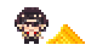

# MajimaVpet

A tiny pixel-art Majima that lives on your macOS desktop. He idles and wanders when you're still, dances when you move the mouse, chats along while you type, and reacts when you pick him up.

<p>
  
  
  
  
  
  
</p>

<p>
  
  
  
  
</p>

## Behaviour

| Category | Animations | Trigger |
|---|---|---|
| **Steady** | idle, walk | Cursor still for 1.5s: idles and takes short walks (20–40px) in any direction, bouncing off screen edges |
| **Interactive** | shock → confuse | Drag him anywhere on screen: "!" while held, "?" after you drop him |
| **Showtime** | change → dance | Cursor moving: sparkle entrance, then dances until the cursor stops |
| **Typing** | typing | Keyboard in use: a speech bubble fills with "…" until you stop typing (0.5s) |
| **Notes** | notetake | Double-click Majima: he stops and gets ready to take a note (see below) |

The pet window floats above other windows and stays in the same spot on every desktop (Space), including full-screen apps and Mission Control. It doesn't even flicker while desktops slide. Clicks pass through its transparent areas.

## Notebook

### Write a note

**Double-click Majima → click him again (within 10s) → write → choose:**

| Key / button | Result |
|---|---|
| **Enter** or **Save** | Saved to your notebook, with date, time and `#labels` |
| **⌥↩** | New line (e.g. the word's meaning) |
| **Quick** | Yellow sticky on screen until you close it, not saved unless you click its **Save** |
| **Esc** | Discarded |

### Read your notes

**Menu bar icon → Notebook…** (⌘B)

- Find text with search box
- Label menu → `#label` → show only those notes

## Pomodoro

**Menu bar icon → Start Pomodoro… → type your task → Enter**

| Stage | Length | Majima shows |
|---|---|---|
| Focus | 25 min | A pile of gold that grows every 5 minutes |
| Short break | 5 min | A "05" clock (after focus 1–3) |
| Long break | 30 min | A "30" clock (after the 4th focus, then a new round starts) |

When a focus ends, Majima walks to the middle of the screen and shows off his full pile of gold. Then he asks **Task finished?** in a speech bubble:
- **Done** ends the task. He celebrates with a green tick and shows how many pomodoros it took.
- **Not yet** starts the break.

The timer waits until you answer. When a break ends, he walks to the middle again, says "Back to work!", and the next focus starts. One minute before a break ends, a soft sound and "1 minute left" remind you. Majima stays where the alarm left him; drag him anywhere you like.

If you're away, the alarm repeats every minute (up to 10 times) until you touch the mouse or keyboard. Click Majima to end an alarm early.

While a pomodoro is running, the menu shows the time left and lets you **Pause**, **Skip Break**, mark the **Task Finished**, or **Stop**. **Mute Alarm Sounds** turns the sounds off but keeps Majima's walk and messages. You can still double-click Majima to write a note at any time.

**Your own sounds:** put `focus-end`, `break-end`, `warning` or `task-done` (`.m4a`, `.mp3`, `.wav` or `.aiff`) in a `sounds/` folder next to the GIFs. They replace the built-in sounds (Glass, Hero, Tink, Funk). The `sounds/` folder is never uploaded.

Each finished pomodoro is saved in `majima.db` with its task, so your focus history is kept.

## Your notes

### Delete and recover

| To… | Do this |
|---|---|
| Delete | Select a note in the Notebook window and click **Delete**. It moves to Recently Deleted. |
| Recover | Choose **Recently Deleted** in the label menu, select the note and click **Restore**. |
| Erase one now | In Recently Deleted, select the note and click **Delete Forever**. This cannot be undone. |
| Erase all now | In Recently Deleted, click **Empty Recently Deleted**. This cannot be undone. |
| Erase automatically | Notes left in Recently Deleted for 30 days are erased for you. Change `trash_days` to adjust. |

### Where they are saved

- File → `~/Library/Application Support/MajimaVpet/majima.db` (only on your Mac, never uploaded)
- Open the folder → Finder → **⇧⌘G** → paste `~/Library/Application Support/MajimaVpet` → Return

### Back up, restore, move

| To… | Do this |
|---|---|
| Back up | Time Machine backs the file up automatically. For your own copy, quit Majima and copy `majima.db` somewhere safe. |
| Restore a backup | Quit Majima, put your copy back in the same folder, then start Majima again. |
| Move to a new Mac | Copy `majima.db` into the same folder on the new Mac before starting Majima there. |
| Read without Majima | Open `majima.db` in any SQLite viewer, such as DB Browser for SQLite. |

Upgrading from an older version → `notes.db` is renamed to `majima.db` automatically.

## Menu bar

Click the little Majima icon in the menu bar:

- **Notebook…** (⌘B): browse, search and delete saved notes
- **Hide / Show Majima** (⌘H)
- **Pause / Resume** (⌘P): freezes the animation
- **Quit MajimaVpet** (⌘Q)

> On macOS 26+, if the icon doesn't appear, enable the app under **System Settings → Menu Bar → Allow in the Menu Bar**.

## Setup

Requires macOS and Python 3.

```bash
python3 -m venv program/venv
program/venv/bin/pip install -r program/requirements.txt
```

## Run

Double-click `MajimaVpet.app`, or from a terminal:

```bash
program/venv/bin/python program/vpet_mac.py
```

## Tweaks

Settings at the top of `program/vpet_mac.py`:

| Setting | Default | Meaning |
|---|---|---|
| `scale` | `1` | Sprite scale (nearest-neighbour, stays crisp) |
| `still_after` | `1.5` | Seconds of cursor stillness before leaving Showtime |
| `walk_speed` | `1` | Pixels per tick while walking |
| `walk_loops` | `(1, 2)` | Walk cycles per stroll (~20px each) |
| `dropped_loops` | `2` | Times the "?" plays after a drop |
| `typing_after` | `0.5` | Seconds after the last key press that still count as typing |
| `notetake_timeout` | `10.0` | Seconds to click Majima again after double-clicking, before he goes back to normal |
| `drag_threshold` | `3` | Pixels the mouse must move before a press becomes a drag |
| `trash_days` | `30` | Days a deleted note stays in Recently Deleted before it is removed for good |
| `focus_minutes` / `short_break_minutes` / `long_break_minutes` | `25` / `5` / `30` | Pomodoro stage lengths |
| `pomodoros_per_section` | `4` | Focus rounds before a long break |
| `alarm_repeat_every` / `alarm_repeat_max` | `60` / `10` | How often and how many times the alarm repeats while you're away |
| `fixed_on_desktop_switch` | `True` | Keep Majima and his notebook fixed while desktops slide, like the cursor (uses a private macOS API; falls back to a short flicker if unavailable) |
| `idle_tick` | `0.5` | Loop interval while paused or hidden (saves CPU) |
| `walk_move_every` | `2` | Move the window every N ticks while walking (moving a window costs more than changing frames) |

## Project layout

```
MajimaVpet.app/        macOS launcher bundle (runs program/vpet_mac.py with the venv)
program/vpet_mac.py    the pet: Cocoa window, animation state machine, menu bar item, note box, Notebook window
program/majima_db.py   shared local database (majima.db); each feature keeps its own tables
program/notes_store.py notebook tables: notes, labels, full-text search
program/pomodoro_store.py pomodoro history tables: tasks, pomodoros
fonts/                 Silkscreen pixel font for Majima's messages (SIL Open Font License, see fonts/OFL.txt)
majima-*.gif           sprite animations (80×92; typing, notetake and Pomodoro art are 160×92)
```
